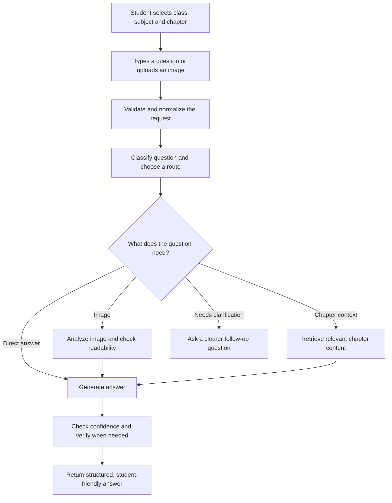

<div align="center">
  
</div>

# NeuroCrack AI Agent — Student Doubt-Solving Assistant

**An AI-powered academic assistant developed by Md. Zubayer Ahmad Shibly for NeuroCrack Technologies as part of professional internship work in 2026.**

**Company:** NeuroCrack Technologies · **University:** Southeast University, Bangladesh  
**Role:** AI Agent Developer (Intern) · **Internship project:** CSE489.1

## About the project

NeuroCrack is an educational platform for students in Bangladesh. This repository contains the **AI doubt-solving agent** I developed for NeuroCrack during my work and internship at **NeuroCrack Technologies**.

The agent helps SSC and HSC students ask academic questions in **Bangla, English, or a mix of both**. Students can type a question or upload an image, select their **class, subject, and chapter**, and receive an organized explanation.

I developed the agent and its local web interface, tested and refined the workflows, and handed the work over to the company for integration into its application. I also prepared an internship report, submitted my work for **Southeast University's CSE489.1 Internship course**, and presented the project at the university.

**This repository represents my AI-agent development contribution, not the development of the entire NeuroCrack mobile app.** The company's backend team handled final production integration, hosting, authentication, and database connections.

## What the agent can do

- **Solve typed and image-based questions:** Supports text prompts, question photos, OCR/image understanding, and quality checks for unclear images.
- **Understand academic context:** Uses the selected class, subject, and chapter to guide the answer.
- **Work in Bangla and English:** Handles Bangla-first, English, and mixed-language academic questions.
- **Recognize question formats:** Supports MCQ, creative questions (CQ), short answers, mathematics, and structured explanations.
- **Retrieve chapter information:** Uses retrieval-augmented generation (RAG), OpenAI embeddings, and a custom in-memory vector store to find relevant chapter content when available.
- **Choose the right AI model:** Uses lightweight and stronger OpenAI model tiers depending on question complexity and confidence.
- **Check uncertain responses:** Includes verification, clarification, and confidence-based handling rather than always giving an unsupported answer.
- **Show readable answers:** Renders mathematical steps, tables, selected MCQ options, and other structured output in the React interface.
- **Use recent chat context:** Supports short-term conversation memory for follow-up questions.
- **Record useful diagnostics:** Includes logging and test cases for the agent's main processing steps.

## How it works

This is a **controlled, graph-based AI workflow**, built using LangGraph. The system follows defined steps; it is **not a fully autonomous, tool-calling agent**.



In simple terms, the agent first understands the question, decides whether it needs image analysis or supporting content, and then prepares an answer suitable for the student's academic level.

## Technology stack

| Area | Tools and technologies |
| --- | --- |
| Language | TypeScript |
| Frontend | React 19, TanStack Router, Tailwind CSS, shadcn/ui, Radix UI |
| Full-stack application | TanStack Start server functions |
| AI workflow | LangGraph and LangChain |
| Language models | OpenAI API (configurable lightweight and strong model tiers) |
| Image understanding | OpenAI vision-based extraction and verification |
| RAG | OpenAI embeddings, chapter documents, custom in-memory vector search |
| Validation | Zod |
| Mathematics | KaTeX |
| Local conversation storage | Browser localStorage |
| Optional public reference | Wikipedia REST API |

## Repository structure

The main source files are organized as follows:

```text
NeuroCrack-AI-Agent/
├── src/
│   ├── api/ask.ts                 # Question submission server function
│   ├── components/chat/           # Chat UI and answer rendering
│   ├── data/                      # Academic subject/chapter information
│   ├── routes/                    # Login, home and chat pages
│   └── server/
│       ├── config.ts              # Server-side configuration
│       └── lib/
│           ├── agent.ts           # Agent entry point
│           ├── graph.ts           # LangGraph workflow
│           ├── ocr-pipeline.ts    # Image-based question processing
│           ├── vector.ts          # Local vector retrieval
│           ├── model-policy.ts    # Model selection
│           ├── confidence.ts      # Confidence handling
│           ├── verification.ts    # Answer checking
│           └── ...                # Supporting agent modules
├── tests/                         # Golden cases, image and parsing tests
├── public/                        # Brand assets
├── .env.example                   # Example environment settings
└── package.json                   # Dependencies and scripts
```

## Run locally

**Requirements:** Node.js and npm, plus an OpenAI API key for AI-backed features.

1. Clone the repository:

```bash
git clone https://github.com/iamshibly/NeuroCrack-AI-Agent.git
cd NeuroCrack-AI-Agent
```

2. Install the dependencies:

```bash
npm ci
```

3. Create a local environment file from the example:

```bash
cp .env.example .env
```

4. Open `.env` and set your own key:

```dotenv
OPENAI_API_KEY=your_openai_api_key_here
```

The example file also documents optional model choices and feature flags. **Never commit your actual API key.** Keep AI requests and secret configuration on the server side.

5. Start the local development server:

```bash
npm run dev
```

Open the local address printed in Terminal. API-backed answers require a working key and network access; OpenAI API usage may incur charges.

**Other available scripts:** `npm run build`, `npm run preview`, and `npm run lint`. The repository also contains test source files under `tests/`, but does not currently define a separate `npm test` script.

## My work at NeuroCrack Technologies

This project was developed as part of my **professional work and internship at NeuroCrack Technologies**. The main internship period ran from **March to May 2026**.

My responsibilities included studying the company's learning product, planning the AI-agent workflow, implementing the local full-stack agent, handling Bangla-English and image questions, adding chapter-based retrieval, building structured answers, testing the system, and preparing it for handover.

After local development and testing, the AI-agent work was **submitted to the company** for integration into the NeuroCrack product. The company's backend developers managed final deployment and production-level services. I also supported testing of the feature after integration.

### University internship submission

The same work formed the technical basis of my **CSE489.1 Internship** at the **Department of Computer Science and Engineering, Southeast University**. I submitted an internship report titled:

> **AI Agent Developer – Development of an AI-Powered Student Doubt-Solving Agent**

The report was submitted on **July 16, 2026**, and I presented the project at the university as part of my internship work.

**Academic supervisor:** Radiathun Tasnia, Lecturer, Southeast University  
**Company supervisor:** Md. Rakibur Rahman, Co-Founder and CTO, NeuroCrack Technologies

## Testing and development scope

During development, I tested the major flows: class/subject/chapter selection, typed questions, image-based questions, structured answers, mathematical rendering, clarifications, and error handling.

My internship report also documents later testing of the integrated NeuroCrack mobile and web features.

**Local prototype boundaries:** The local implementation used an in-memory vector store and browser-based short-term chat storage. It did **not** include a production database, an external vector database, long-term memory, streaming answers, MCP, LangGraph subgraphs, or autonomous tool selection. Those features should not be inferred from the word “agent.”

The internship report documents **functional test evidence**, not a formal benchmark accuracy score. The company-side production infrastructure is separate from the code in this repository.

## Developer and acknowledgments

**Developed by Md. Zubayer Ahmad Shibly**  
Computer Science and Engineering, **Southeast University**, Bangladesh  
GitHub: [@iamshibly](https://github.com/iamshibly)

I am grateful to **NeuroCrack Technologies** for the opportunity to work on this project, to **Md. Rakibur Rahman** for professional supervision, and to **Radiathun Tasnia** for academic supervision.

NeuroCrack branding and the larger commercial application belong to their respective owners. This repository documents the **AI-agent work I developed** and should not be confused with the complete company application.
